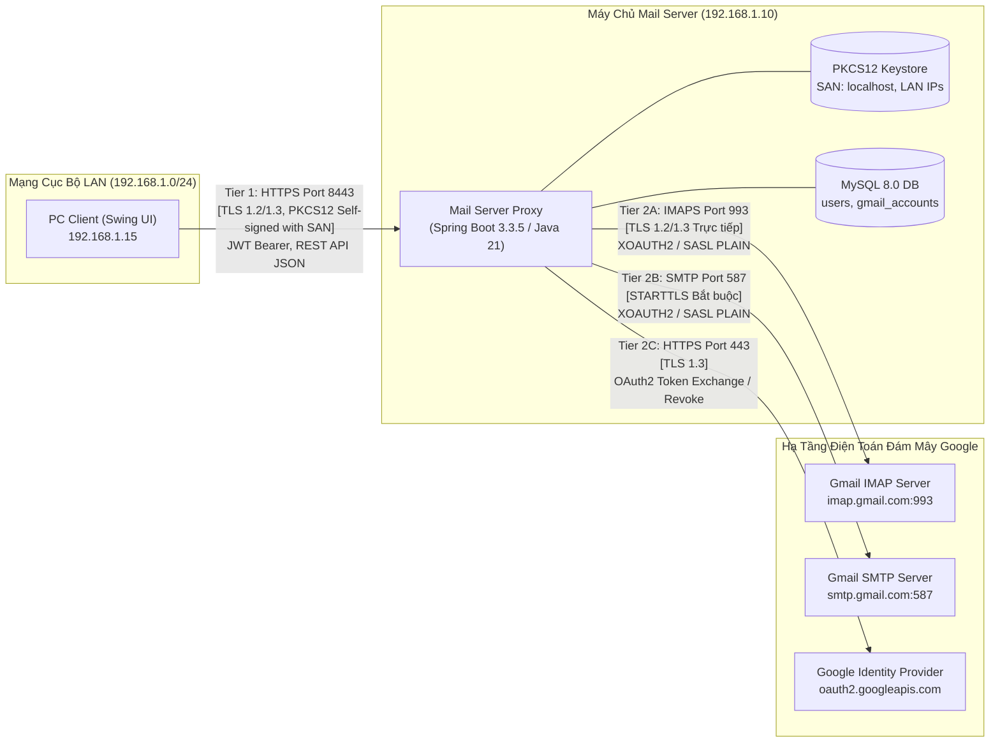

# Sơ Đồ Kiến Trúc Bảo Mật 2 Lớp TLS (Two-Tier TLS Security Architecture)

## 1. Mô Tả Kiến Trúc

Hệ thống **MailManager** tuân thủ mô hình kiến trúc Proxy trung gian an toàn giữa máy trạm Client trong mạng LAN nội bộ và hệ thống máy chủ Gmail của Google:
1. **Lớp 1 (Tier 1 - LAN to Server):** Kênh kết nối giữa **Mail Client (Java Swing)** và **Mail Server (Spring Boot)** được bảo vệ toàn diện bằng giao thức **HTTPS qua cổng 8443**. Chứng chỉ số chuẩn PKCS12 tự ký chứa đầy đủ SAN (Subject Alternative Names) cho cả tên miền và các IP trong mạng LAN. Toàn bộ thông tin trao đổi (tên đăng nhập, mật khẩu, JWT token, nội dung thư) đều được mã hóa trên đường truyền.
2. **Lớp 2 (Tier 2 - Server to Google):** Kênh kết nối từ **Mail Server** ra ngoài Internet tới các máy chủ của Google được phân tách độc lập theo từng giao thức:
   - **Tier 2A (IMAP):** Cổng `993` qua giao thức IMAPS được bọc TLS 1.2/1.3 ngay từ đầu.
   - **Tier 2B (SMTP):** Cổng `587` qua giao thức SMTP STARTTLS bắt buộc nâng cấp mã hóa TLS trước khi truyền bất kỳ lệnh xác thực hay nội dung thư nào.
   - **Tier 2C (Google OAuth2 API):** Cổng `443` HTTPS kết nối tới `oauth2.googleapis.com` để đổi mã ủy quyền (code exchange) và thu hồi quyền (revoke).

---

## 2. Sơ Đồ Trực Quan (Mermaid)

