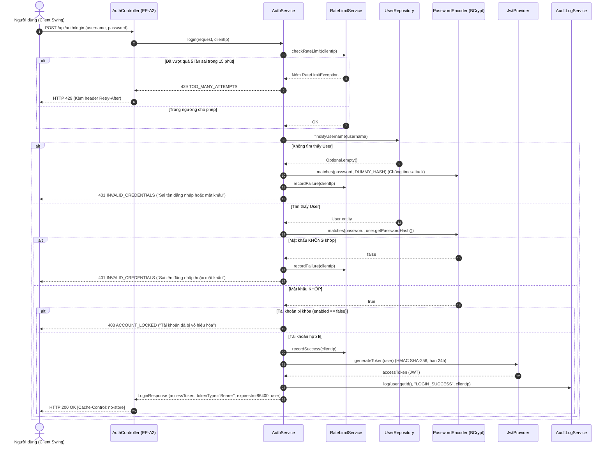

# Sơ Đồ Tuần Tự Đăng Nhập & Cấp Phát JWT (EP-A2: POST /api/auth/login)

## 1. Mô Tả Luồng Nghiệp Vụ & Cơ Chế Phòng Thủ

Luồng đăng nhập hệ thống được thiết kế theo các tiêu chuẩn bảo mật khắt khe:
1. **Phòng thủ Brute-force (Rate Limiting):** Giới hạn tối đa 5 lần đăng nhập thất bại từ cùng một địa chỉ IP trong khung thời gian 15 phút. Khi vi phạm, trả về ngay HTTP 429 kèm header `Retry-After`.
2. **Chống dò quét tài khoản (Timing Attack Protection):** Nếu `username` không tồn tại trong hệ thống, `AuthService` vẫn cố tình thực hiện một phép kiểm tra băm BCrypt với một chuỗi hash giả lập (`DUMMY_HASH`) để đảm bảo thời gian phản hồi giữa trường hợp tài khoản không tồn tại và trường hợp sai mật khẩu là tương đương nhau. Luôn trả về thông báo chung `INVALID_CREDENTIALS`.
3. **Bảo mật trạng thái tài khoản:** Trạng thái khóa (`enabled == false`) chỉ được phản hồi sau khi người dùng đã nhập đúng mật khẩu, tránh làm lộ thông tin tài khoản bị khóa cho kẻ tấn công.
4. **Cấp phát JWT an toàn:** JWT được ký bằng thuật toán HMAC SHA-256 với secret tối thiểu 256 bits, thời hạn 24 giờ. Header phản hồi chứa `Cache-Control: no-store` ngăn chặn cache token.

---

## 2. Sơ Đồ Tuần Tự (Mermaid)

