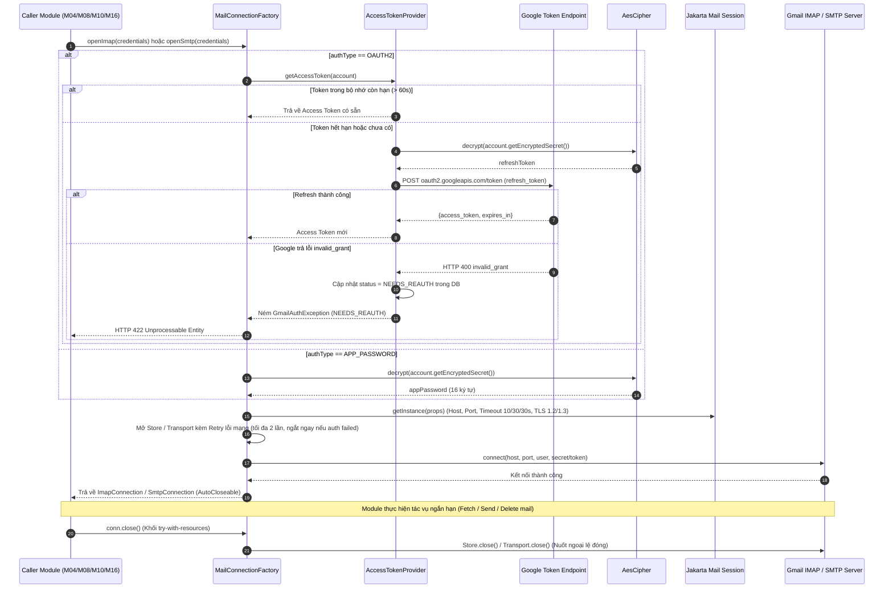

# Sơ Đồ Tuần Tự Bộ Điều Phối Kết Nối Ngắn Hạn MailConnectionFactory (Module M07)

## 1. Mô Tả Cơ Chế Kết Nối Ngắn Hạn & Xử Lý Lỗi

Module `MailConnectionFactory` chịu trách nhiệm cung cấp kết nối `Store` (IMAP) và `Transport` (SMTP) đã được xác thực an toàn tới Gmail cho tất cả các thành viên trong nhóm (M04, M08, M10, M16):
1. **Không cache kết nối mở dài hạn:** Mọi kết nối chỉ mở cho một yêu cầu ngắn hạn và đóng ngay sau khi thao tác xong thông qua mẫu thiết kế `AutoCloseable` (`ImapConnection`, `SmtpConnection`). Phương thức `close()` nuốt toàn bộ ngoại lệ đóng để không làm gián đoạn luồng nghiệp vụ chính.
2. **Cơ chế XOAUTH2 & Tự động Refresh Token:**
   - Với tài khoản `OAUTH2`, `AccessTokenProvider` tự động kiểm tra thời hạn token trong cache in-memory.
   - Nếu token còn hạn > 60 giây, tái sử dụng token.
   - Nếu token sắp hết hạn hoặc hết hạn, tự động dùng Refresh Token (đã giải mã AES-GCM) gọi Google Token Endpoint lấy token mới.
   - Nếu Google phản hồi lỗi `invalid_grant` (người dùng đổi mật khẩu hoặc hủy quyền trên trang quản lý Google Account), Factory đánh dấu trạng thái tài khoản là `NEEDS_REAUTH` trong DB và ném `GmailAuthException` tương ứng HTTP 422, yêu cầu người dùng xác thực lại.
3. **Phân biệt Lỗi Mạng và Lỗi Xác Thực (Retry Policy):**
   - Lỗi mạng (`SocketTimeoutException`, `ConnectException`): Hệ thống tự động retry (tối đa 2 lần, khoảng cách 300ms).
   - Lỗi xác thực (`AuthenticationFailedException`): **Tuyệt đối không retry**, ném ngoại lệ ngay lập tức để tránh làm khóa tài khoản Gmail của người dùng.

---

## 2. Sơ Đồ Tuần Tự (Mermaid)

