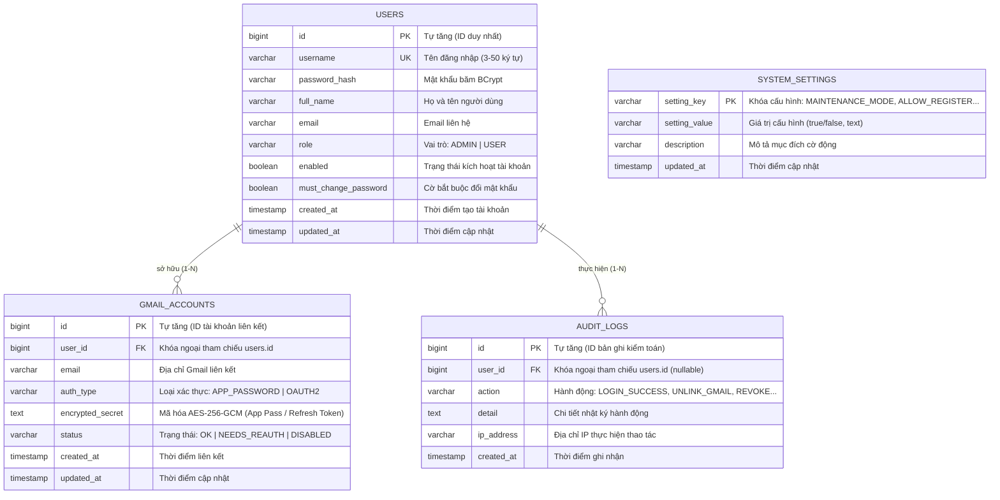

# Sơ Đồ Thực Thể - Quan Hệ Cơ Sở Dữ Liệu (Entity-Relationship Diagram)

## 1. Mô Tả Kiến Trúc Cơ Sở Dữ Liệu MySQL 8.0

Cơ sở dữ liệu của **Mail Server** được thiết kế tinh gọn gồm 4 bảng, tuân thủ nguyên tắc **KHÔNG lưu nội dung thư điện tử (No Mail Caching)** trong hệ thống:
1. **`users`:** Lưu thông tin tài khoản đăng nhập của người dùng vào hệ thống `MailManager`. Mật khẩu được mã hóa một chiều bằng giải thuật **BCrypt**. Quản lý phân quyền RBAC (`ADMIN`, `USER`) và trạng thái kích hoạt (`enabled`).
2. **`gmail_accounts`:** Lưu thông tin liên kết tài khoản Gmail của từng người dùng (quan hệ 1-N với `users`). Trường `encrypted_secret` lưu App Password (16 ký tự) hoặc OAuth2 Refresh Token được **mã hóa đối xứng AES-256-GCM**, tuyệt đối không lưu dữ liệu thô.
3. **`system_settings`:** Lưu các cờ động hệ thống phục vụ quản trị runtime (như `MAINTENANCE_MODE`, `ALLOW_REGISTRATION`), cho phép thay đổi cấu hình mà không cần khởi động lại Server.
4. **`audit_logs`:** Ghi vết kiểm toán bảo mật (Security Audit Logging) các hành vi quan trọng: đăng nhập, đổi mật khẩu, liên kết/hủy liên kết Gmail, thu hồi token, kèm địa chỉ IP client và thời gian chính xác.

---

## 2. Sơ Đồ Thực Thể - Quan Hệ (Mermaid)

