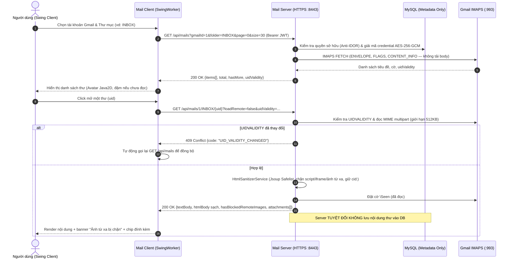

# Biểu Đồ Tuần Tự: Đọc Thư & Làm Sạch HTML An Toàn (M08)

Biểu đồ mô tả luồng liệt kê hộp thư tối ưu bằng `FetchProfile` (không tải nội dung thân thư), đọc chi tiết MIME, kiểm tra `UIDVALIDITY`, làm sạch HTML chống XSS/tracking pixel và nguyên tắc **Server không bao giờ lưu nội dung email vào CSDL**.

