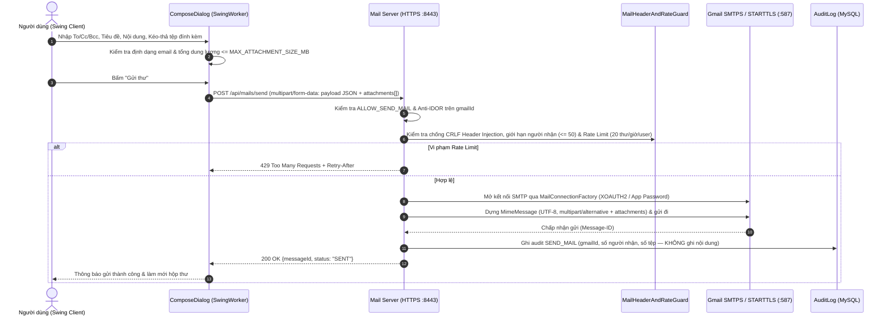

# Biểu Đồ Tuần Tự: Soạn & Gửi Thư Multipart qua SMTP (M10)

Biểu đồ mô tả quy trình gửi thư kèm tệp đính kèm từ `ComposeDialog` qua `Mail Server` (có kiểm tra `ALLOW_SEND_MAIL`, chống CRLF Header Injection, giới hạn dung lượng `MAX_ATTACHMENT_SIZE_MB`, Rate Limit theo user) tới Gmail SMTP và ghi Audit Log không lưu nội dung thư.

