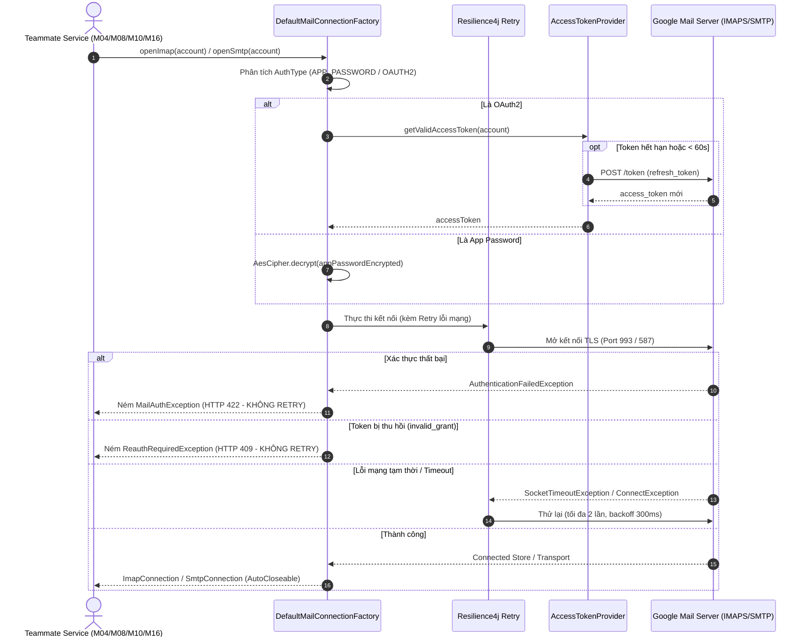

# Hướng dẫn tích hợp MailConnectionFactory (M07)

> **Tác giả:** Lê Thanh Cường (Module M07 & M06)  
> **Áp dụng cho:** Toàn bộ thành viên nhóm (TV2 — Thành, TV4 — Khánh, TV5 — Thọ, TV6 — Đức)  
> **Package:** `com.mailapp.mail`  

---

## 1. Tổng quan & Nguyên tắc cốt lõi

`MailConnectionFactory` là **bộ điều phối kết nối duy nhất** đến Google Gmail (IMAP over TLS và SMTP STARTTLS). Mọi module đọc mail, gửi mail, xóa mail hay kiểm tra thông tin liên kết **bắt buộc** gọi qua Factory này, không tự ý khởi tạo `Session`, `Store` hay `Transport` riêng lẻ.

### Các nguyên tắc thiết kế:
1. **Không cache session toàn cục:** Mỗi lần mở kết nối là một `Session` độc lập với `debug=false`, tránh rò rỉ credential giữa các người dùng.
2. **AutoCloseable an toàn:** `ImapConnection` và `SmtpConnection` triển khai `AutoCloseable`. Phương thức `close()` nuốt sạch ngoại lệ để đảm bảo an toàn tuyệt đối khi dùng trong khối `try-with-resources`.
3. **Bảo mật thông tin xác thực:** `MailCredentials.toString()` luôn che mật khẩu và token (`secret=***`, `c***@gmail.com`). Log hệ thống tuyệt đối không in secret.
4. **Tự động phân luồng xác thực:** Factory tự động phát hiện `AuthType.APP_PASSWORD` hoặc `AuthType.OAUTH2` (SASL `XOAUTH2`) dựa trên entity `GmailAccount`.

---

## 2. Sơ đồ luồng mở kết nối (Mermaid)



---

## 3. Hướng dẫn tích hợp cho từng Module

### 3.1. Cao Tất Thành (TV2 — M04: Thêm & Kiểm tra Gmail App Password)
Khi người dùng nhập form email + App Password 16 ký tự, gọi `testImap` để kiểm tra đăng nhập thật với Gmail trước khi lưu vào DB. Hàm này **không bao giờ ném exception cho lỗi dự kiến**:

```java
@Autowired
private MailConnectionFactory mailConnectionFactory;

public void linkGmailWithAppPassword(Long userId, String email, String rawAppPassword) {
    // 1. Thử đăng nhập IMAP thật với Gmail
    ConnectionTestResult testResult = mailConnectionFactory.testImap(email, rawAppPassword);
    
    if (!testResult.isSuccessful()) {
        switch (testResult.status()) {
            case AUTH_FAILED -> throw new AppException(HttpStatus.UNPROCESSABLE_ENTITY, "GMAIL_AUTH_FAILED", testResult.message());
            case IMAP_DISABLED -> throw new AppException(HttpStatus.UNPROCESSABLE_ENTITY, "IMAP_DISABLED", testResult.message());
            case NETWORK_ERROR -> throw new AppException(HttpStatus.BAD_GATEWAY, "GMAIL_CONNECTION_ERROR", testResult.message());
        }
    }

    // 2. Nếu thành công -> Mã hóa và lưu DB
    String encryptedPassword = aesCipher.encrypt(rawAppPassword);
    // ... lưu vào bảng gmail_accounts
}
```

---

### 3.2. Trần Nguyễn Hữu Khánh (TV4 — M08: Đọc mail IMAP)
Khi fetch danh sách thư mục hoặc tải danh sách mail:

```java
@Autowired
private MailConnectionFactory mailConnectionFactory;

@Autowired
private GmailFolderResolver folderResolver;

public List<MailSummaryDto> fetchInboxMails(GmailAccount account, int page, int size) {
    // Luôn sử dụng try-with-resources để tự động đóng kết nối IMAP
    try (ImapConnection imap = mailConnectionFactory.openImap(account)) {
        Folder inbox = imap.folder("INBOX");
        inbox.open(Folder.READ_ONLY);

        // Fetch danh sách mail theo trang
        // ...
        inbox.close(false);
        return mailList;
    } catch (MessagingException e) {
        throw new MailNetworkException("Không thể đọc hộp thư đến", e);
    }
}

// Phân giải thư mục theo chuẩn đa ngôn ngữ (không hardcode tiếng Anh):
public Folder getSentFolder(ImapConnection imap) throws MessagingException {
    return folderResolver.resolve(imap.getStore(), GmailFolderResolver.SpecialFolder.SENT);
}
```

---

### 3.3. Nguyễn Tá Thọ (TV5 — M10: Soạn & Gửi mail qua SMTP)
Khi gửi mail:

```java
@Autowired
private MailConnectionFactory mailConnectionFactory;

public void sendMail(GmailAccount account, SendMailRequest request) {
    // Mở kết nối SMTP an toàn
    try (SmtpConnection smtp = mailConnectionFactory.openSmtp(account)) {
        MimeMessage message = smtp.createMimeMessage();
        
        message.setFrom(new InternetAddress(account.getEmail()));
        message.setRecipients(Message.RecipientType.TO, InternetAddress.parse(request.to()));
        message.setSubject(request.subject(), "UTF-8");
        
        // Dựng body text/html và đính kèm...
        message.setText(request.body(), "UTF-8");
        
        // Gửi qua Transport đã xác thực
        smtp.sendMessage(message);
    } catch (MessagingException e) {
        throw new MailNetworkException("Gửi thư thất bại qua SMTP", e);
    }
}
```

---

### 3.4. Trần Minh Đức (TV6 — M16: Xóa mail theo cơ chế Trash)
Khi người dùng xóa mail, di chuyển vào thùng rác trên Gmail:

```java
@Autowired
private MailConnectionFactory mailConnectionFactory;

@Autowired
private GmailFolderResolver folderResolver;

public void moveMailToTrash(GmailAccount account, String sourceFolderName, long uid) {
    try (ImapConnection imap = mailConnectionFactory.openImap(account)) {
        Folder source = imap.folder(sourceFolderName);
        source.open(Folder.READ_WRITE);

        Folder trash = folderResolver.resolve(imap.getStore(), GmailFolderResolver.SpecialFolder.TRASH);

        Message msg = ((UIDFolder) source).getMessageByUID(uid);
        if (msg != null) {
            source.copyMessages(new Message[]{msg}, trash);
            msg.setFlag(Flags.Flag.DELETED, true);
            source.expunge();
        }
        source.close(true);
    } catch (MessagingException e) {
        throw new MailNetworkException("Không thể chuyển thư vào Thùng rác", e);
    }
}
```

---

## 4. Bảng mã lỗi & Ánh xạ HTTP Status

| Ngoại lệ | HTTP Status | Error Code | Nguyên nhân | Hành động gợi ý cho Client |
|---|:---:|---|---|---|
| `MailAuthException` | `422` | `GMAIL_AUTH_FAILED` | Sai App Password hoặc token bị từ chối | Yêu cầu nhập lại App Password chính xác |
| `ReauthRequiredException` | `409` | `GMAIL_NEEDS_REAUTH` | OAuth2 refresh token bị Google thu hồi | Mở lại luồng OAuth2 để liên kết lại |
| `ImapDisabledException` | `422` | `IMAP_DISABLED` | Chưa bật IMAP trong Settings của Gmail | Hướng dẫn bật IMAP trên web Gmail |
| `MailNetworkException` | `502` / `504` | `GMAIL_CONNECTION_ERROR` | Mất mạng, timeout, lỗi TLS handshake | Thông báo kiểm tra đường truyền và thử lại |

---

## 5. Cấu hình tham số (`application.properties`)

```properties
# Bật Virtual Threads Java 21 (IMAP / SMTP socket I/O là blocking I/O)
spring.threads.virtual.enabled=true

# Cấu hình kết nối Gmail
mail.gmail.imap.host=imap.gmail.com
mail.gmail.imap.port=993
mail.gmail.smtp.host=smtp.gmail.com
mail.gmail.smtp.port=587

# Timeouts (đơn vị: mili-giây)
mail.gmail.connection-timeout-ms=10000
mail.gmail.timeout-ms=30000
mail.gmail.write-timeout-ms=30000

# Cấu hình Resilience4j Retry lỗi mạng
mail.gmail.retry.enabled=true
mail.gmail.retry.max-attempts=2
mail.gmail.retry.wait-duration-ms=300
```

> **Tại sao cần Virtual Threads của Java 21?**  
> Các tác vụ IMAP và SMTP qua Jakarta Mail là thao tác Blocking Socket I/O. Khi người dùng fetch mail hoặc gửi mail dung lượng lớn, luồng xử lý sẽ bị block chờ mạng. Sử dụng Virtual Threads giúp Spring Boot phục vụ hàng ngàn kết nối đồng thời mà không làm cạn kiệt pool luồng nền tảng (OS threads) của máy chủ.

---

## 6. Hướng dẫn thiết lập Gmail cho kiểm thử

### 6.1. Bật IMAP trên Gmail
1. Truy cập [Gmail Web](https://mail.google.com/) $\rightarrow$ Bấm icon bánh răng **Cài đặt** $\rightarrow$ **Xem tất cả chế độ cài đặt**.
2. Chọn tab **Chuyển tiếp và POP/IMAP**.
3. Tại mục **Quyền truy cập qua IMAP**, chọn **Bật IMAP**.
4. Bấm **Lưu thay đổi**.

### 6.2. Tạo App Password (Mật khẩu ứng dụng 16 ký tự)
1. Đảm bảo tài khoản Gmail đã bật **Xác minh 2 bước (2-Step Verification)**.
2. Truy cập [Quản lý tài khoản Google](https://myaccount.google.com/security).
3. Tìm kiếm **Mật khẩu ứng dụng (App passwords)**.
4. Đặt tên ứng dụng (ví dụ: `MailApp PTIT`) và bấm **Tạo**.
5. Google sẽ cấp một mật khẩu gồm 16 ký tự (định dạng placeholder: `<GMAIL_APP_PASSWORD_16_KY_TU>`). Lưu lại chuỗi này để sử dụng trên Mail App.

### 6.3. Tích hợp XOAUTH2 thật (Nối Module M06 và M07)
1. **Điều phối Access Token**: `DefaultAccessTokenProvider` kết nối trực tiếp với `OAuth2Service.getFreshAccessToken(account)`.
2. **Cơ chế Caching & Lock**: Access Token được lưu trong bộ nhớ RAM qua **Caffeine Cache** (hết hạn trước 60 giây so với Google), tuyệt đối **không lưu Access Token vào DB**. Mỗi tài khoản được bảo vệ bằng khóa đồng bộ (`accountLocks`) để tránh race condition khi nhiều luồng cùng gọi làm mới token.
3. **Cơ chế SASL XOAUTH2**: Cả IMAP và SMTP đều được cấu hình cơ chế SASL chuẩn:
   - `mail.imaps.auth.mechanisms=XOAUTH2` & `mail.imaps.sasl.enable=true`
   - `mail.smtp.auth.mechanisms=XOAUTH2` & `mail.smtp.sasl.enable=true`
   - Tắt các cơ chế xác thực thuần không an toàn: `auth.login.disable=true`, `auth.plain.disable=true`.
4. **Xử lý thu hồi quyền (Invalid Grant)**: Khi Google trả về lỗi `invalid_grant` (người dùng đổi mật khẩu hoặc hủy quyền trên trang bảo mật Google), hệ thống tự động cập nhật `status = NEEDS_REAUTH`, lưu DB, ghi Audit Log và ném `ReauthRequiredException` để Client nhắc người dùng liên kết lại.

### 6.4. Chạy kiểm thử tích hợp với Gmail thật
Sử dụng thống nhất 2 biến môi trường `GMAIL_TEST_EMAIL` và `GMAIL_TEST_APP_PASSWORD` thông qua script an toàn (nhập mật khẩu ẩn bằng `Read-Host -AsSecureString`, chỉ truyền cho tiến trình con, không lưu và không in giá trị):
```powershell
cd "Mail Server"
.\scripts\test-real-gmail.ps1
```

