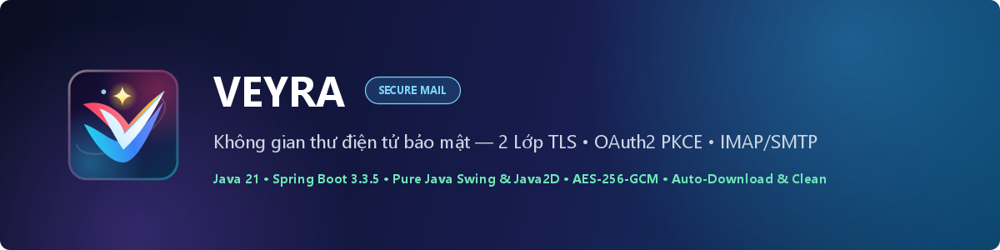

# Veyra Mail — Hệ Thống Quản Lý Thư Điện Tử Bảo Mật

Đồ án môn **Lập trình Mạng — PTIT** | Kiến trúc Client–Server bảo mật **TLS 2 lớp** (`Mail Client` ↔ `Mail Server` qua **HTTPS TLS 1.3 :8443**, `Mail Server` ↔ `Gmail` qua **IMAPS :993** & **SMTP STARTTLS :587**).

> **Nguyên tắc kiến trúc cốt lõi:**
> - **Giữ nguyên IMAP/SMTP cho cả OAuth2 và App Password:** Google OAuth2 dùng `SASL XOAUTH2` qua IMAPS/SMTP, **không** chuyển sang Gmail REST API.
> - **Không lưu nội dung email vào CSDL:** Server chỉ lưu metadata tài khoản và làm proxy streaming tới Gmail, đóng kết nối trong `try-with-resources`/`finally`.
> - **Client tuyệt đối không kết nối trực tiếp tới Gmail/Google:** Mọi thao tác hộp thư, tải đính kèm và tải ảnh đại diện Google đều đi qua `Mail Server` (chống IDOR & SSRF).

---

## 1. Công nghệ & Kiến trúc

| Thành phần | Công nghệ chính |
| :--- | :--- |
| **Backend (`Mail Server`)** | Java 21 LTS (**Virtual Threads / Project Loom**), Spring Boot `3.3.5`, Spring Security `6.3.10`, Spring Data JPA, Tomcat `10.1.62` (HTTPS PKCS12), MySQL `8.0`, **Flyway** (`V1` → `V3` Java Migration), Jakarta Mail / Angus Mail `2.0.3`, **IMAPS Connection Pool**, Caffeine RAM Cache, Resilience4j Retry, Jsoup `1.24.1`, JJWT `0.12.6` (`HS256`), SpringDoc OpenAPI 3 |
| **Frontend (`Mail Client`)** | **Pure Java 21 Swing + Java2D** (System Look & Feel, không dùng FlatLaf), `java.net.http.HttpClient` xác thực TLS chặt theo chứng chỉ `mailapp.cer`, toàn bộ lời gọi mạng chạy bất đồng bộ bằng `SwingWorker`, hỗ trợ Chủ đề Sáng / Tối & HiDPI |
| **Hạ tầng & Đóng gói** | Docker Compose (`mailapp-mysql` + `mailapp-server`), Gradle Wrapper (`./gradlew` / `.\gradlew.bat`), PowerShell scripts (`gen-keystore.ps1`, `run-server.ps1`, `test-real-gmail.ps1`, `open-firewall.ps1`) |

---

## 2. Tính năng nổi bật

### 2.1. Xác thực & Bảo mật chuẩn Production
- **Đăng nhập linh hoạt:** Hỗ trợ đăng nhập bằng **Tên đăng nhập hoặc Email + Mật khẩu** (`POST /api/auth/login`) và **Đăng nhập trực tiếp bằng Google OAuth2** (`POST /api/auth/oauth2/google/start`, `GET /api/auth/oauth2/google/poll` — tự động hợp nhất an toàn khi trùng email đã xác thực).
- **Bảo vệ JWT & Tài khoản:** JWT ký tường minh bằng **`HS256`**, chống Brute-force (Rate Limit 5 lần sai / 15 phút, trả `429` + `Retry-After`), chống Timing-Attack, chống IDOR ở mọi endpoint, bắt buộc đổi mật khẩu lần đầu (`MustChangePasswordFilter`), mã hóa App Password & Refresh Token bằng **AES-256-GCM**.
- **Khởi động an toàn (`SecurityStartupValidator`):** `ADMIN_INITIAL_PASSWORD` mặc định chỉ tồn tại ở profile `dev`; môi trường `prod`/non-dev thiếu hoặc yếu `JWT_SECRET`, `AES_KEY`, `KEYSTORE_PASSWORD`, `ADMIN_INITIAL_PASSWORD` sẽ tự động dừng khởi động.

### 2.2. Đa phương thức đăng nhập trên cùng MỘT hộp thư Gmail (Flyway V3)
- **Một hộp thư — Nhiều phương thức:** Cùng một hộp thư Gmail có thể gắn đồng thời **Google OAuth2 (PKCE S256)** và **App Password (16 ký tự)** trên đúng **1 bản ghi** `gmail_accounts` (cột `auth_type` là phương thức chính `preferredMethod`).
- **Chuẩn hóa `email_key` dùng chung Server & Client (`EmailNormalizer`):**
  - Cắt khoảng trắng, hạ chữ thường.
  - Riêng `gmail.com` / `googlemail.com`: bỏ toàn bộ dấu chấm `.` và phần `+tag` ở phần local, quy đổi `googlemail.com` → `gmail.com` (ví dụ `John.Doe+work@googlemail.com` → `johndoe@gmail.com`).
  - Tên miền khác (Google Workspace, công ty, trường học...): chỉ hạ chữ thường và cắt khoảng trắng.
  - Giữ nguyên cột `email` gốc để hiển thị.
- **Upsert giao dịch & chống trùng thân thiện:** Cả OAuth2 Callback lẫn `POST /api/gmail-accounts/app-password` đều tìm theo `(user_id, email_key)` trong transaction (có retry an toàn khi xảy ra race condition `UNIQUE`), giữ nguyên `id` và `displayName`, trả cờ `outcome` (`CREATED` | `METHOD_ADDED` | `METHOD_UPDATED`) cùng thông điệp tiếng Việt — **không bao giờ trả lỗi trùng**.
- **Pre-check cục bộ ngay trên Client:** Ở Wizard App Password, ngay khi gõ email (kể cả biến thể dấu chấm/`+tag`/`googlemail.com`), Client tự chuẩn hóa so với danh sách cục bộ và báo ngay *"Hộp thư này đã được liên kết bằng Google. Bấm 'Thêm App Password' để dùng làm dự phòng"* trước khi gọi mạng.
- **Tự động Fallback OAuth2 → App Password:** Khi phương thức chính `OAUTH2` gặp `ReauthRequiredException` (hết hạn / bị thu hồi quyền) mà hộp thư có App Password:
  - Server tự chuyển dùng App Password cho thao tác đó (đánh dấu `fallbackActive=true`, ghi audit `FALLBACK_TO_APP_PASSWORD` không ghi bí mật).
  - **Không xóa** trạng thái `NEEDS_REAUTH` của OAuth2; Client hiện dải cam *"Đang dùng App Password dự phòng - Google cần cấp lại quyền"* kèm nút **Cấp lại quyền**.
  - Không retry lỗi xác thực nhiều lần (tránh bị Google khóa tài khoản).
- **Quản lý phương thức:** Đổi phương thức chính (`PUT /api/gmail-accounts/{id}/preferred-method`), gỡ từng phương thức (`DELETE /api/gmail-accounts/{id}/methods/{OAUTH2|APP_PASSWORD}` — thu hồi token Google best-effort hoặc xóa bí mật; gỡ phương thức cuối bắt buộc `confirmUnlink=true`).
- **Ảnh đại diện Google qua Server Proxy:** `GET /api/gmail-accounts/{id}/avatar` kiểm tra chủ sở hữu (chống IDOR) và whitelist chặt host `https://lh*.googleusercontent.com` (chống SSRF), cache RAM 1 giờ.

### 2.3. Hộp thư thật, Hiệu năng cao & Tải đính kèm + Dọn thư
- **Tối ưu tốc độ chống Timeout:** Kết hợp **Java 21 Virtual Threads**, **IMAPS Connection Pool** theo từng tài khoản và **Caffeine RAM Cache** ngắn hạn (25s–60s, tuyệt đối không ghi DB).
- **Đầy đủ nghiệp vụ hộp thư:** Thư mục chuẩn hóa RFC 6154 (tên tiếng Việt + số thư chưa đọc), liệt kê dùng `FetchProfile` (không tải body), tìm kiếm `X-GM-RAW`, đọc MIME (UTF-8, RFC 2047/2231), làm sạch HTML bằng Jsoup Safelist & mặc định chặn ảnh từ xa, tải đính kèm dạng stream (RFC 5987, `X-Content-Type-Options: nosniff`), gửi thư multipart (rate limit 20 thư/giờ/user, chống CRLF injection), xóa mềm/vĩnh viễn, gắn sao / đánh dấu đã đọc.
- **Nghiệp vụ cốt lõi — Tải đính kèm rồi Xóa thư:** Hỗ trợ thủ công & Tự động dọn định kỳ (mặc định **TẮT**, hỗ trợ dry-run, nút Dừng), lưu tại `<Downloads>/MailManager/<email>/<yyyy-MM-dd>/`, chống Path Traversal (`../`), chống ghi đè (`file (1).pdf`), xác minh dung lượng + **SHA-256** trước khi xóa. Tải lỗi hoặc hủy giữa chừng **tuyệt đối không xóa thư**.
- **Bảng Quản trị Hệ thống (Admin 4 tab):** Quản lý User (tạo, khóa/mở khóa vô hiệu JWT tức thì, đổi vai trò, reset mật khẩu 1 lần, xóa cascade + revoke OAuth2, chặn tự khóa/xóa & chặn hạ quyền ADMIN cuối), Cấu hình hệ thống động, Thống kê 7 ngày, Nhật ký Audit & xuất CSV chống CSV Injection.

---

## 3. Cấu trúc dự án

```text
MailManager/
├── Mail Server/                      # Spring Boot 3.3.5 (Java 21, HTTPS :8443, MySQL 8, Flyway V1-V3)
│   ├── src/main/java/
│   │   ├── db/migration/             # Flyway Java Migration V3 (email_key, dedup an toàn, multi-auth)
│   │   └── com/mailapp/              # controller, service, mail, oauth2, security, model, dto, util
│   ├── src/main/resources/
│   │   └── db/migration/             # Flyway SQL V1__init.sql, V2__gmail_last_verified_at.sql
│   ├── docs/                         # Hợp đồng API, sơ đồ Mermaid, hướng dẫn OAuth2, Swagger, mail.http
│   ├── scripts/                      # gen-keystore, run-server, test-real-gmail, open-firewall, dev-down
│   ├── docker-compose.yml            # MySQL 8.0 (host :3307) + Mail Server (HTTPS :8443)
│   └── .env.example                  # Mẫu biến môi trường (KHÔNG commit .env thật)
├── Mail Client/                      # Pure Java Swing Desktop App (System L&F + Java2D, Veyra UI)
│   └── src/main/resources/icons/     # Bộ icon thương hiệu Veyra PNG 16..512 & veyra.ico
├── docs/
│   └── banner.png                    # Banner thương hiệu Veyra Mail
├── architechture/docs/               # Đặc tả tổng thể, phân công nhóm & chi tiết các task
└── README.md                         # Tài liệu tổng quan và hướng dẫn chạy dự án
```

---

## 4. Yêu cầu môi trường

- **JDK 21 LTS** (OpenJDK 21 / Eclipse Temurin 21 / Amazon Corretto 21).
- **Docker Desktop** (chạy MySQL 8.0 và/hoặc Mail Server container).
- **Gradle Wrapper** đi kèm sẵn trong cả hai module (`.\gradlew.bat` trên Windows, `./gradlew` trên Linux/macOS).
- *(Tùy chọn cho OAuth2 thật)* Tài khoản **Google Cloud Console** đã tạo OAuth Client ID (Web Application) với Redirect URI: `https://localhost:8443/api/oauth2/callback`.

---

## 5. Hướng dẫn cấu hình & Chạy dự án (từ bản clone sạch)

### Bước 1: Tạo tệp biến môi trường `.env`
Sao chép từ mẫu `.env.example` (tuyệt đối **không** commit tệp `.env` lên Git):

```powershell
cd "Mail Server"
Copy-Item .env.example .env
```

Mở `Mail Server/.env` và điền đầy đủ các biến bắt buộc:

| Biến môi trường | Bắt buộc | Mô tả & Cách tạo nhanh |
| :--- | :---: | :--- |
| `MYSQL_DATABASE` | Có | Tên CSDL, mặc định `mailapp_db` |
| `MYSQL_USER` | Có | Tài khoản MySQL, mặc định `mailapp` |
| `DB_PASSWORD` | Có | Mật khẩu MySQL (tự chọn, đủ mạnh) |
| `KEYSTORE_PASSWORD` | Có | Mật khẩu bảo vệ chứng chỉ `keystore.p12` (>= 6 ký tự) |
| `ADMIN_INITIAL_PASSWORD` | Có (prod) | Mật khẩu tài khoản `admin` khởi tạo lần đầu (>= 8 ký tự, có chữ + số; bắt buộc đổi khi đăng nhập lần đầu) |
| `JWT_SECRET` | Có | Chuỗi bí mật HMAC SHA-256 dài **>= 32 byte**. Sinh bằng PowerShell:<br>`-join ((48..57)+(65..90)+(97..122) \| Get-Random -Count 48 \| ForEach-Object {[char]$_})` |
| `AES_KEY` | Có | Khóa AES-256 dạng Base64 giải mã đúng **32 byte**. Sinh bằng PowerShell 5.1/7+:<br>`$b = New-Object byte[] 32; [System.Security.Cryptography.RandomNumberGenerator]::Create().GetBytes($b); [Convert]::ToBase64String($b)` |
| `GOOGLE_CLIENT_ID` | Tùy chọn | Client ID từ Google Cloud Console (bắt buộc nếu dùng Google OAuth2) |
| `GOOGLE_CLIENT_SECRET` | Tùy chọn | Client Secret từ Google Cloud Console (bắt buộc nếu dùng Google OAuth2) |
| `GOOGLE_REDIRECT_URI` | Tùy chọn | Mặc định `https://localhost:8443/api/oauth2/callback` |

### Bước 2: Sinh chứng chỉ TLS tự ký (HTTPS :8443)
Chạy script sau trong thư mục `Mail Server` — script sẽ tự sinh `keystore.p12` (cho Server) và tự đồng bộ `mailapp.cer` sang `Mail Client/certs/mailapp.cer` (và `certs/mailapp.cer` gốc):

```powershell
cd "Mail Server"
.\scripts\gen-keystore.ps1
```

> **Lưu ý khi dùng trình duyệt mở OAuth2 Callback (`https://localhost:8443/api/oauth2/callback`):** Do là chứng chỉ tự ký cục bộ, lần đầu trình duyệt sẽ hiện cảnh báo *"Kết nối không phải là riêng tư"* → bấm **Nâng cao (Advanced)** → **Tiếp tục tới localhost (Proceed to localhost)** để hoàn tất liên kết.

---

### Bước 3: Khởi động Backend (`Mail Server`)

Bạn có thể chọn **1 trong 2 cách**:

#### Cách A — Chạy bằng Docker Compose (Khuyên dùng, profile `prod` mặc định)
```powershell
cd "Mail Server"
docker compose up -d --build
```
Kiểm tra máy chủ đã sẵn sàng:
```powershell
curl.exe -k https://localhost:8443/actuator/health
# Kết quả mong đợi: {"status":"UP"}
```
*(Flyway sẽ tự động chạy `V1`, `V2`, `V3` nâng cấp schema MySQL ngay khi khởi động.)*

Dừng Docker Compose khi không dùng:
```powershell
cd "Mail Server"
docker compose down
```

#### Cách B — Chạy cục bộ bằng Gradle hoặc IntelliJ IDEA (chế độ phát triển `dev`)
1. Chỉ bật container MySQL từ Docker Compose (lắng nghe cổng host `3307`):
   ```powershell
   cd "Mail Server"
   docker compose up -d mysql
   ```
2. Sau khi MySQL sẵn sàng, chạy trực tiếp bằng Gradle trong thư mục `Mail Server`:
   ```powershell
   .\gradlew bootRun
   ```
   Gradle tự chọn JDK 21 đã cài; ứng dụng tự nạp `.env`, dùng profile `dev` nếu chưa cấu hình profile và kết nối MySQL theo `MYSQL_PORT` / `MYSQL_DATABASE`. Không cần đặt lại `JAVA_HOME` hoặc truyền JDBC URL mỗi lần. Gradle Wrapper vẫn cần JVM tương thích với Gradle (tối thiểu Java 17 cho dự án Spring Boot này).
   *(Trong profile `dev`, Swagger UI mở tại `https://localhost:8443/swagger-ui.html`.)*

---

### Bước 4: Khởi động Desktop App (`Mail Client`)

```powershell
cd "Mail Client"
.\gradlew.bat run
```
- **Chế độ mặc định (bảo mật):** Client tự động xác thực chứng chỉ TLS của Server bằng tệp `Mail Client/certs/mailapp.cer`.
- **Chế độ dev bỏ qua kiểm tra chứng chỉ (hiển thị dải đỏ cảnh báo):**
  ```powershell
  .\gradlew.bat run -Pinsecure=true
  ```
- **Đăng nhập lần đầu bằng tài khoản Admin:** Username `admin`, mật khẩu theo `ADMIN_INITIAL_PASSWORD` trong `.env` (hệ thống sẽ yêu cầu đổi mật khẩu ngay lần đầu).
- **Đăng nhập / Liên kết người dùng thường:** Bấm **Đăng ký ngay** hoặc dùng nút **Tiếp tục với Google** ngay trên màn hình đăng nhập.

---

### Bước 5: Cấu hình Gmail thật (OAuth2 & App Password)

1. **Google OAuth2 (`GOOGLE_CLIENT_ID` / `GOOGLE_CLIENT_SECRET`):**
   - Xem hướng dẫn chi tiết từng bước tại [Mail Server/docs/oauth2-setup.md](Mail%20Server/docs/oauth2-setup.md).
   - Ở chế độ *Testing* trên Google Cloud Console, nhớ thêm các địa chỉ Gmail cần thử nghiệm vào mục **OAuth consent screen → Test users** (hoặc bấm **Publish App**).
2. **Gmail App Password (16 ký tự):**
   - Bật **Xác minh 2 bước (2-Step Verification)** trên tài khoản Google.
   - Tạo mật khẩu ứng dụng tại `https://myaccount.google.com/apppasswords`.
   - Trong `Mail Client`, mở **Tài khoản Gmail → Dùng App Password (3 bước)** (hoặc bấm **Thêm phương thức đăng nhập** trên hộp thư đã liên kết Google để gắn thêm App Password làm dự phòng).

---

## 6. Kiểm thử tự động (Số liệu thực chạy)

Chạy toàn bộ kiểm thử sạch từ đầu (không cần MySQL hay mạng internet — dùng H2 `MODE=MySQL`, GreenMail và MockWebServer):

```powershell
# Kiểm thử Mail Server
cd "Mail Server"
.\gradlew.bat clean test --rerun-tasks

# Kiểm thử Mail Client
cd "..\Mail Client"
.\gradlew.bat clean test --rerun-tasks
```

*(Tùy chọn)* Kiểm thử tích hợp với Gmail thật (nhập thông tin ẩn, không lưu/in mật khẩu):
```powershell
cd "Mail Server"
.\scripts\test-real-gmail.ps1
```

### Kết quả kiểm thử mới nhất (`./gradlew clean test --rerun-tasks`)

| Thành phần | Số lớp test | Tổng test | Đạt (Pass) | Bỏ qua (Skip) | Lỗi |
| :--- | :---: | :---: | :---: | :---: | :---: |
| **Mail Server** | 33 | **155** | **153** | 2 *(Gmail thật)* | 0 |
| **Mail Client** *(offline mặc định)* | 15 | **66** | **56** | 10 *(Live Server E2E)* | 0 |
| **TỔNG CỘNG** | **48** | **221** | **209** | **12** | **0** |

---

## 7. Tài liệu kỹ thuật liên quan

- [Hợp đồng API Hộp thư & Đa phương thức Gmail (`Mail Server/docs/api-mail-contract.md`)](Mail%20Server/docs/api-mail-contract.md)
- [Hợp đồng API Xác thực & OAuth2 cho Client (`Mail Server/docs/client-auth-contract.md`)](Mail%20Server/docs/client-auth-contract.md)
- [Hợp đồng API Quản trị Hệ thống (`Mail Server/docs/api-admin-contract.md`)](Mail%20Server/docs/api-admin-contract.md)
- [Hướng dẫn thiết lập Google OAuth2 (`Mail Server/docs/oauth2-setup.md`)](Mail%20Server/docs/oauth2-setup.md)
- [Ma trận kiểm thử tự động (`Mail Server/docs/testing/test-matrix.md`)](Mail%20Server/docs/testing/test-matrix.md)
- [Sơ đồ kiến trúc & tuần tự Mermaid (`Mail Server/docs/diagrams/`)](Mail%20Server/docs/diagrams/)
- [Tệp gọi thử HTTP (`Mail Server/docs/http/mail.http`)](Mail%20Server/docs/http/mail.http)
- [Hướng dẫn chạy & phát triển trên IntelliJ IDEA (`Mail Server/docs/INTELLIJ.md`)](Mail%20Server/docs/INTELLIJ.md)
- [Tài liệu bàn giao kỹ thuật (`Mail Server/docs/HANDOVER.md`)](Mail%20Server/docs/HANDOVER.md)
- [Ghi chú phát hành (`RELEASE_NOTES.md`)](RELEASE_NOTES.md)
